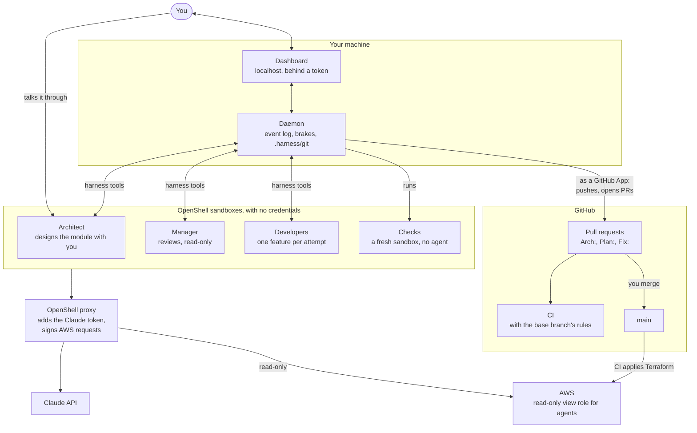

# razzou-harness

**Your AI dev team, with you in charge.**

You describe a module, a part of the system you want to build. An Architect designs it
with you, Developers build it one feature at a time, and a Manager reviews each one.
Every agent works in its own [OpenShell](https://github.com/NVIDIA/OpenShell) sandbox
with no credentials, every feature is checked in a fresh one, and nothing reaches `main`
until you merge its pull request. A small daemon runs the loop, following Anthropic's
[Effective harnesses for long-running agents](https://www.anthropic.com/engineering/effective-harnesses-for-long-running-agents).
That is Manual mode. For a project too large to read in full, [Swarm mode](#swarm-mode)
lets the daemon merge the plans that pass CI and two reviewers.

- [How it works](#how-it-works)
- [Requirements](#requirements)
- [Install and set up a project](#install-and-set-up-a-project)
- [Your first module](#your-first-module)
- [Concepts](#concepts)
- [The dashboard](#the-dashboard)
- [Swarm mode](#swarm-mode)
- [Commands](#commands)
- [Configuration](#configuration)
- [AWS and Terraform](#aws-and-terraform)
- [Security](#security)
- [Usage and costs](#usage-and-costs)
- [Troubleshooting](#troubleshooting)
- [Development](#development)

## How it works



You start a module in the dashboard, and talk with its Architect (Claude Code,
interactive) in its terminal. The Architect asks you questions until the need is clear,
writes proposals until you accept one, then turns it into plans, features, checks and
owner actions. These reach `main` as an `Arch:` pull request that you merge. Then the
daemon builds the module, feature by feature:
- it starts a Developer (Claude Code) in a fresh sandbox, with a 2-attempt budget and a
  deadline;
- it checks the result in another fresh sandbox, which has no agent;
- a long-lived Manager (Claude Code, read-only) reviews what passed, answers the
  Developer's questions, and gives the guidance a failed attempt's successor starts
  with;
- the daemon lands each accepted feature as one commit on the plan branch, in its own
  git repository under `.harness/git`. When a plan is done, all its checks run again,
  and the Manager submits it;
- the daemon pushes the plan branch and opens one pull request for it, as a GitHub App
  with no access to workflows. CI checks the PR with the rules of the base branch. If CI
  fails, the Manager diagnoses it and a Developer fixes it, twice at most. You merge,
  or the daemon does in [Swarm mode](#swarm-mode).

Infrastructure features take the same path. Agents see AWS through a read-only role
whose requests the OpenShell proxy signs, so they plan against the real state but never
write. A check can assert on that plan. CI plans again with its own role, and applies
`main` after the merge. Post-deploy checks then test the real resources, and a failed
apply or post-deploy check gets a `Fix:` pull request, twice at most.

Agents reach the daemon only through harness tools: a small MCP server inside each
sandbox relays their calls through files, and the daemon decides. Everything is recorded
in an event log, so the daemon picks up where it stopped after a restart, while the
agents keep working. Without `project.repo`, a project stays local: plans complete
without pull requests.

## Requirements

- Linux, Node 24 or later, git, Docker, and `gh` logged in as an admin of your
  project's repository.
- OpenShell 0.1.2 with a running gateway. The harness is tested with this version only,
  and `harness doctor` refuses others.
- Claude Code on this machine, with a Claude subscription: its binary goes into the
  sandbox image, and `claude setup-token` gives the agents' token. Access with an API
  key is untested.
- For terminals in the dashboard: `python3`, `make` and `g++`, to build node-pty at
  install. Without them, everything else works, and `harness attach` opens the
  Architect's terminal.
- On GitHub, for pull requests:
  - **An organization** that owns your project's repository: `harness github-app
    create` creates the harness's App in an organization. A free one works.
  - **Rulesets** protect `main`. GitHub offers them on private repositories only with a
    paid plan, such as Team for an organization; public repositories get them for free.
    Without them, nothing on GitHub makes code wait for your review before it reaches
    `main`, and `harness doctor --probe` reports it.

## Install and set up a project

```sh
npm install -g razzou-harness --allow-scripts=node-pty
cd path/to/project && harness setup   # the rest, asking only for what is yours
```

The command is also installed as `razzou-harness`, for machines where another `harness`,
such as the Harness.io CLI, comes first on the PATH.

`harness setup` does every step it can and asks only for what is yours: a `gh` login,
the token from `claude setup-token` at a hidden prompt, two clicks on GitHub for the
App, since GitHub creates and installs Apps only in the browser, three questions (your
stack's network bundles, AWS or not, the hours of your time), and, with AWS, the role
ARNs from your bootstrap and the gateway key. In order, it logs you in to `gh`; creates
the repository on GitHub if the project has no remote; creates the App from its
manifest when this machine has none, and waits for you to install it; writes the
harness's files; asks the questions and writes `harness/config.json`, with the
`staging` environment and the variables on GitHub for AWS; commits the files it wrote,
and only those, with your git once you agree, and pushes them when you are on `main`;
runs `harness doctor` and fixes what it can (starts the OpenShell gateway, builds the
agents' image, imports the Claude profile and creates the provider with your token,
applies the ruleset on `main`, creates the AWS provider with your key); runs the probe;
and offers to start the daemon. Run it again at any time: what is done is skipped, and a
setup commit that wasn't pushed is offered again. On a private repository of a free
plan, where GitHub has no rulesets, it says so and goes on.

The same by hand: `harness init` writes the harness's files into the repository, never
over existing ones, and prints the setup checklist:
1. Docker, and OpenShell with a running gateway.
2. The Claude subscription: `claude setup-token`, then `harness doctor` in a terminal
   creates the provider, with the token typed at a hidden prompt.
3. The GitHub App, once per machine: `harness github-app create --org <org>`, then install
   it on the project repositories only.
4. The repository rules: `harness github-setup --repo <org>/<repo>`, with your own `gh`.
5. AWS, for infrastructure: see [AWS and Terraform](#aws-and-terraform).
6. Review the files `init` wrote, commit them, and push them to `main` yourself: the App
   may not touch workflows.
7. `harness doctor --probe`.

`harness doctor --build-images` builds the agents' image, `harness doctor --probe` runs
the probe, and `harness up` starts the daemon. `harness doctor` checks each step, and
says what to do about what fails. `--probe` tries,
from a sandbox like an agent's and from outside, everything that must be refused: AWS
writes and secret reads, other projects' state, `git push`, unlisted hosts and the
metadata address, a workflow pushed by the App, a merge without your approval.

`harness init` lets the sandboxes reach only the `core` network bundle. Add your
stack's bundles, such as `node` for npm, in `harness/config.json` (see
[Configuration](#configuration)).

## Your first module

With `harness up` running and the dashboard open:

1. **Start it.** In **Project**, give the module an id and a line about what it is for,
   then **Start**. An Architect starts in its own sandbox. From a terminal:
   `harness module new greeter "A greeting command-line tool"`.
2. **Talk it through.** In **Agents**, open the Architect's terminal and say what you
   need. It reads the repository, asks its questions, then writes a proposal: the
   problem, the design, the plans it expects, and what only you can do. From a terminal:
   `harness attach greeter`, and detach with Ctrl-P, then Ctrl-Q.
3. **Accept a proposal.** **Needs you** shows it. Accept it, or ask for changes in the
   terminal, and the Architect writes the next version. Once you accept one, the
   dashboard prompts the Architect, which turns it into plans, features and checks, and
   the daemon opens an `Arch:` pull request with them. Its new checks run once first: they should fail,
   since nothing is built yet, and any that pass are flagged.
4. **Merge the design.** Review the Arch PR on GitHub, and merge it with a merge commit
   once CI passes. The build starts.
5. **Watch the build.** In **Agents**, each Developer's session and the Manager's are
   live transcripts. **Project** shows each feature's attempts, checks and commits.
6. **Answer what comes up.** A question from the Manager, or a feature that ran out of
   attempts, appears in **Needs you** with a form or buttons.
7. **Merge the plan.** When all of a plan's features are accepted and its checks pass
   again, the daemon opens one `Plan:` pull request. Merge it with a merge commit once
   CI passes. The next plan starts.

You can also write a module's design by hand, on `main`: the daemon builds whatever
plans it finds there (see [Configuration](#configuration)).

## Concepts

- **Module:** a part of the system you want to build, with one Architect and one
  accepted proposal, then its plans. Modules are built one after another, in both modes:
  the one under way is finished before the next starts, and only it has Developers,
  Managers and reviewers. Every module's Architect stays available, so you can design the
  next module while one is built; its plans wait their turn. Size a module
  so that its design fits in one conversation. With the default model, Opus 5.5, the
  Architect's context holds up to a million tokens, and a well-sized module never fills
  it. If a module's design keeps growing, split it into smaller modules: each gets its
  own Architect, with a fresh context.
- **Proposal:** the Architect's design document, in versions v1, v2 and so on. You
  accept one.
- **Plan:** features that ship together as one pull request. A module's plans are built
  in order. A plan is `CODE`, `INFRA` or `MIXED`, from its features' kinds: the kind is
  tagged in the pull request's title, and a `CODE` plan's pull request may not touch
  the Terraform folder. Give infrastructure plans of its own.
- **Feature:** one change that a Developer can make in one attempt, with at least one
  check. A design change can redefine it while its plan is built: an attempt under way
  stops, and the feature is built again with a fresh budget, even if it was accepted.
  Once its plan is past its build (every feature of it accepted, then its pull request
  and merge), it is frozen: a change goes in a new plan.
- **Check:** a shell command, run from the repository root, that exits 0 when the feature
  works. `pre-merge` checks run on every attempt and in CI; `post-deploy` checks run
  after an infrastructure deploy.
- **Attempt:** one Developer session on one feature, in a fresh sandbox, with a deadline
  (120 minutes) and a budget (2 attempts per feature). A failed attempt's successor
  starts with the Manager's guidance. Once the budget is spent, the feature is escalated
  to you.
- **Owner actions:** what only you can do, such as creating an account, approving a
  policy or setting a secret. A **gate** holds back the plans or features it blocks
  until you mark it done; a **task** holds nothing back.
- **Protected files:** the design and its checks, CI, and what agents read as
  instructions: `harness/`, `.github/`, `ARCHITECTURE.md`, `init.sh`, and in any folder
  `.claude/`, `CLAUDE.md`, `CLAUDE.local.md` and `AGENTS.md`, which Claude Code reads
  wherever they are; the configs that decide what a check runs (ESLint, Prettier, Biome,
  Vitest, Vite, Jest, Babel, Playwright, Mocha, pytest, tox, and package.json's `jest`,
  `babel` and `mocha` fields); and the npm scripts that checks run. A `Plan:` or `Fix:`
  pull request may not change them, nor add a local link to `package-lock.json`: CI's
  `verify` job, run with the base branch's rules, fails it, and the daemon refuses it
  first. They change through an `Arch:` pull request, also judged by the base branch's
  rules, so what it newly protects counts from the next one, or your own commits.
  `harness/lock.json` holds their hashes.
- **`progress.txt`:** one line per accepted feature and satisfied gate, committed with
  the work. It only grows. When plans in parallel both add lines, the daemon keeps both.
- **Brakes:** counters and deadlines, not judgment. Three failed attempts in a row, a
  Manager that leaves an item waiting for 180 minutes, or CI still failing after two fix
  rounds pause the pipeline until you resume it. A usage limit pauses it for an hour,
  and never shortens a pause already there.

## The dashboard

`harness up` runs the daemon in the foreground and opens the dashboard: localhost only,
behind a token. Its views:
- **Needs you:** questions from the Manager, proposals to accept, pull requests to merge,
  escalations, owner actions, a paused pipeline. Each has its button or form.
- **Project:** modules, proposals, plans and features, with attempts, findings, CI,
  deploys and `progress.txt`.
- **Agents:** the Architect's terminal, the Manager's and the Developers' live
  transcripts, a message box for the Manager, and a shell in any agent's sandbox. An
  attempt's card keeps the network requests its sandbox's policy refused.
- **Sandboxes:** what runs on the OpenShell gateway. This project's sandboxes, with what
  each is for, whether anything still uses it, and the CPUs and memory it uses now,
  read from `docker stats` every five seconds. A left-over one, which a crash or a
  failed delete left, has a button to delete it; the daemon deletes them itself when it
  starts and every hour, except an Architect's. Select one to see the network requests
  its policy refused, from its log: the program, the host, why, and how often. Then the
  other projects' sandboxes, which the dashboard only lists, and the gateway's status.
  Above them, the caps on each new sandbox: how many CPUs and how much memory it may
  use, so that agents and checks in parallel leave the machine usable. There is no cap
  until you set one.
- **Events:** the event log, live, with a filter.

The header pauses and resumes the pipeline: a pause lets what runs finish, and starts
nothing new. It also shows the mode, Manual or Swarm, and switches it.

## Swarm mode

Manual mode, the default, is what the rest of this README describes: you review and
merge every pull request. Past a certain size you become the bottleneck. Swarm mode
gives the agents more autonomy and you less to read. Its design is
`docs/architecture/proposal-v3.md` in the source repository; this section says what
exists today.

**The switch.** The dashboard's header switches the mode; so do `harness mode swarm`
and `harness mode manual`. A switch takes effect at item boundaries: what runs
finishes under the rules it started with. GitHub's rules on `main` differ per mode, and
only you can change them: `harness mode` applies the mode's ruleset in the same
command, with your own `gh`; after a switch from the dashboard, run
`harness github-setup --repo <org>/<repo>` once. Until the rules match nothing merges.
The daemon reads the rules in effect on `main` through the App and the dashboard's
note lists what is still to do, the commands ready to copy: the rules, the App's
"Commit statuses: write", and the token for the usage probe. The note goes once all
three are done; `harness doctor` checks the same.

**What merges itself.** In Swarm the daemon merges a plan's pull request, as the App,
once CI passed and every status in `swarm.requiredStatuses` is green on its head:
- a `CODE` plan, when `swarm.merge.code` is `daemon`;
- an `INFRA` or `MIXED` plan, when the monthly cost it adds, estimated by CI, is at or
  under `swarm.merge.infraMonthlyUsdCeiling`; or, once the header's button **Let the
  daemon merge infra** is on, like a `CODE` plan, once CI and both reviewers pass, an
  estimate over the ceiling still waiting for you. The button is off by default, and
  the choice is recorded in the event log.

Only an estimate of the pull request's current head counts: after a fix round, the new
head needs its own. Before it merges, the daemon merges `main` into the pull request's
branch if `main` moved since CI ran, so CI and the reviewers judge what `main` gets; a
conflict leaves the pull request to you, to resolve on GitHub.

Anything else waits for you, under **Needs you** with the reason. `Arch:` and `Fix:`
pull requests are yours in both modes. In Swarm, GitHub's rules need no approval but
require the reviewers' statuses, pinned to the App, so even the daemon can't merge
before they pass. The reviewers read plan pull requests only: the daemon gives an
`Arch:` or `Fix:` pull request the two statuses as "not reviewed", so you merge it
without bypassing the rules, and CI still gates it.

**Before a launch.** In Swarm the daemon reads your subscription's usage before it
starts an attempt, and at or above `swarm.usageCeilingPercent` the pipeline waits for
the window to reset. It reads it with the token `harness doctor` stores in
`~/.config/harness/claude.token` when it creates the Claude provider; on an older
setup, the doctor asks for the token again once Swarm is on. Without it, the daemon
learns of a limit only when an attempt hits it, as in Manual.

**The reviewers.** Once CI passed on a plan's pull request, two reviewers read it, one
after the other, each in a fresh read-only sandbox with the Manager's permissions: a
security reviewer and a cost reviewer, with `roles/security.md` and `roles/cost.md`
as their prompts and the Manager's model. Each gets a brief: the plan's features, the
files changed, the pay-per-use AWS calls the change adds or removes, found by pattern
in the code, and the Terraform plan's JSON when the project has one. Each answers
with a verdict and findings. The daemon posts the findings on the pull request as a
review, with comments on the lines of the diff, and sets the reviewer's commit status,
`harness/security` or `harness/cost`. A blocking verdict opens a fix round on the
plan branch, like a CI failure: a Developer fixes with the findings as guidance, the
Manager reviews, CI and the reviewers run again on the new head. A blocking finding
blocks, whatever the verdict says. After `swarm.securityFixRounds` or
`swarm.costFixRounds`, the pull request is yours. In Manual,
`swarm.reviewersInManual` runs them as comments and statuses that gate nothing.

The App needs **Commit statuses: write** for the verdicts. An App created before this
version has read only: give it the permission on GitHub, accept it on the installation,
and `harness doctor` stops warning. Until then, a plan whose reviewer passed waits for
you with the reason.

**Parallel Developers.** In Swarm, up to `swarm.maxDevelopers` Developers build the
features of the plan under way at once, each in its own sandbox, as soon as the
features they depend on are accepted: `dependsOn` in the design decides, so the
Architect is told to declare every dependency. Each attempt starts from the plan
branch as it is. When another feature lands first, the daemon merges the new head
into the attempt before its checks, so they see the accepted work, and the feature
lands as one commit on the head. A conflict interrupts the attempt, without counting
it, and the next one starts from the new head. In both modes, a design change merged
while a feature is built interrupts its attempt the same way, and the next one builds
the new definition. Manual mode builds one feature at a time, as before. In both modes, the
Architect hears in one line when a plan's pull request opens, waits for you, is
blocked by a reviewer, or merges.

**Parallel plans.** A plan may declare `dependsOn`, the plans of its module that must
be merged before it starts; without it, it waits for the previous plan, as always. In
Swarm, up to `swarm.maxPlans` plans of the module under way whose dependencies are
merged build at once, each on its own branch with its own Manager, keyed `module/plan`
in the Agents view. When one merges, `main` is merged into the others, `progress.txt`
keeping both sides' lines; a conflict in other files is resolved in that plan's pull
request. A
feature may also depend on a feature of an earlier plan, as `P1/F03`, and then waits
for that plan's merge. The Project view draws each module's features as a graph, plan
by plan, with an edge per dependency: green accepted, blue under way, red escalated,
grey not started. Manual mode builds one plan at a time with one Manager per module,
as before.

**The cost job.** `harness install-ci` adds a `cost` job to the workflow: on a pull
request that has `iac/`, it runs [Infracost](https://www.infracost.io) on the base and
the head and uploads the estimate as the `cost` artifact, which the daemon reads once
CI passed and the `cost` job itself succeeded. It needs the repository secret `INFRACOST_API_KEY`, a free key from
`infracost auth login`; without it the job does nothing, no estimate exists, and
`INFRA` and `MIXED` plans wait for you with that reason. Infracost sees your Terraform's
resource types and sizes, not your code or state. The cost reviewer gets the estimate in
its brief. The job is not a required check: verify it on your first `INFRA` pull request
in a real repository, since the harness's tests only fake its artifact.

**Where it stands.** The scanners in CI that the security reviewer would start from,
gitleaks, semgrep and checkov, are still to come (proposal v3 §5.5): the reviewer reads
the diff itself.

**Budgets.** In both modes, the Project view shows two meters you set there:
- **Your time.** The hours the whole project may take of you. Once set, every owner
  action in a design, gate or task, carries the Architect's estimate of how long it
  takes you, a reserve of `ownerTime.reservePercent` stays out of what designs may
  plan, and `submit_design` refuses a design whose actions don't fit what remains
  after the other modules. Only owner actions count: the proposals and pull requests
  you read don't. The Architect reads the numbers with `get_owner_time`. The meter
  shows used, planned and the hours, red when over.
- **Agent hours.** The Developers' attempt clocks summed, against a threshold: red when
  over, and nothing stops.

## Commands

Run them in the project's folder, or add `--dir <project>`. `harness --help` lists them
too.

| Command | What it does |
|---|---|
| `harness init` | Writes the harness's files into the repository, and prints the setup checklist |
| `harness doctor [--build-images] [--probe]` | Checks the machine and the project, builds the agents' image, and tries what agents must not do |
| `harness github-app create --org <org>` | Creates the harness's GitHub App, once per machine |
| `harness github-app check --repo <org>/<repo>` | Checks that the App can reach the repository |
| `harness github-setup --repo <org>/<repo> [--mode manual\|swarm]` | Sets merge commits only, and the ruleset on `main` for the daemon's mode, with your own `gh` |
| `harness budget --owner-hours <n>` | Sets the hours of your time for the whole project; with the daemon down, it records them when it starts, over hours set before (`--agent-hours` sets the threshold) |
| `harness setup [--repo <owner/name>] [--owner <login>]` | Sets up this machine and the project, asking only for what is yours; run it again any time |
| `harness install-ci [--owner <login>]` | Writes the workflow, its CI script and `CODEOWNERS` again, after an upgrade |
| `harness lock` | Writes `harness/lock.json`, the hashes of the protected files |
| `harness up`, `harness down` | Starts the daemon and the dashboard, or stops the daemon; sandboxes keep running |
| `harness status` | Plans, features, modules and open questions, in the terminal |
| `harness module new <id> <title>` | Starts a module and its Architect |
| `harness attach <module>` | Opens the Architect's terminal here; detach with Ctrl-P, then Ctrl-Q |
| `harness accept <module> <vN>` | Accepts the Architect's proposal vN |
| `harness actions`, `harness done <module>/<id>` | Lists the owner actions, or marks one done |
| `harness answer <request-id> <text>` | Answers a question from the Manager |
| `harness message <text>` | Writes to the Manager of the module being built |
| `harness retry <module>/<plan>/<feature>` | Gives an escalated feature one more attempt; `--note` adds guidance |
| `harness resume` | Lifts a pause |
| `harness mode [manual\|swarm]` | Shows the mode, or switches it; with the daemon down, it records the switch for when it starts |
| `harness recover` | Rebuilds a lost `.harness/` from GitHub's `main` and branches, and lists what it can't: the mode, the budgets, the owner tasks done |

## Configuration

`harness/config.json` holds the project's settings. It is a protected file: it changes
through an `Arch:` pull request, or a commit of your own on `main`.

```json
{
  "harnessVersion": "0.4.0",
  "project": { "name": "shop", "repo": "<org>/shop", "bot": "<org>-harness[bot]" },
  "roles": {
    "architect": { "model": "claude-opus-5-5", "effort": "max" },
    "manager": { "model": "claude-opus-5-5", "effort": "high" },
    "developer": { "model": "claude-opus-5-5", "effort": "xhigh", "attemptTimeoutMinutes": 90, "maxAttempts": 2 }
  },
  "network": { "bundles": ["core", "node"], "extraHosts": [] },
  "checks": [{ "id": "unit", "run": "npm test", "phase": "pre-merge" }]
}
```

| Field | Default | What it sets |
|---|---|---|
| `project.name` | the folder's name, from `init` | Names the sandboxes and the dashboard |
| `project.repo`, `project.bot` | none | The GitHub repository, and the App's bot login. Without them, the project stays local. |
| `roles.<role>.model` | `claude-opus-5-5` | The model of the Architect, the Manager and the Developers |
| `roles.<role>.effort` | `max`, `high`, `xhigh` | Claude Code's `--effort`; `null` for a model without effort levels, such as Haiku |
| `roles.developer.attemptTimeoutMinutes` | 120 | An attempt's deadline |
| `roles.developer.maxAttempts` | 2 | Attempts per feature before it is escalated to you |
| `network.bundles` | `["core"]` | The hosts sandboxes reach, by bundle: `core`, `node`, `python`, `aws`, `terraform`, `go`, `rust`, `jvm`, `opentofu`, `browsers`. The Architect gets them all. |
| `network.extraHosts` | `[]` | More hosts, read-only |
| `checks` | `[]` | Checks that every feature must keep passing, such as `npm run lint` |
| `protect.files`, `protect.jsonFields` | none | More protected files, as paths or globs (`scripts/*.sh`, `docs/`, `**/Makefile`), and protected JSON fields by file, like `{"tsconfig.json": ["/compilerOptions/strict"]}` |
| `sandbox.image` | `razzou-harness/agent:<version>` | The agents' image, tagged with the harness's version, which `harness doctor --build-images` builds |
| `sandbox.claudeProvider` | `claude-sub` | The OpenShell provider that holds your Claude token |
| `sandbox.env` | `{}` | Environment variables for every sandbox |
| `github.requiredChecks` | `["verify", "checks"]` | The CI jobs a pull request must pass; `tf-plan` is added with Terraform |
| `brakes.consecutiveFailures` | 3 | Failed attempts in a row that pause the pipeline |
| `brakes.managerTurnMinutes` | 90 | How long an item waits for the Manager before a reminder; as long again, and the pipeline pauses |
| `brakes.ciFixRounds`, `brakes.deployFixRounds` | 2, 2 | Fix rounds after CI fails, and `Fix:` pull requests after a deploy fails |
| `ownerTime.reservePercent` | 20 | The share of your hours designs may not plan for owner actions |
| `swarm.merge.code` | `daemon` | Who merges a `CODE` plan in Swarm: `daemon`, or `owner` |
| `swarm.merge.infraMonthlyUsdCeiling` | 50 | The monthly cost an `INFRA` or `MIXED` plan may add and still merge itself in Swarm; `null` leaves them all to you |
| `swarm.requiredStatuses` | `["harness/security", "harness/cost"]` | The App's statuses a pull request needs before the daemon merges it; `[]` merges on CI alone |
| `swarm.maxDevelopers`, `swarm.maxPlans` | 3, 2 | Attempts and plans at once in Swarm |
| `swarm.usageCeilingPercent` | 80 | No launch in Swarm at or above this share of your subscription's limits; `null` turns the probe off |
| `swarm.securityFixRounds`, `swarm.costFixRounds` | 2, 2 | Fix rounds a reviewer may ask for, before you decide |
| `swarm.reviewersInManual` | `false` | Run the reviewers in Manual too, as comments only |
| `dashboard.port` | 4777 | The dashboard's port, or the next free one |
| `aws`, `terraform` | none | See [AWS and Terraform](#aws-and-terraform) |

A module's design lives on `main` too, whether the Architect wrote it or you did:

```
harness/modules/<module>/plans/P1.json        a plan and its features
harness/modules/<module>/checks/...           the scripts its checks run, with synthetic data
harness/modules/<module>/owner-actions.json   gates and tasks for you, if any
```

A plan, `harness/modules/greeter/plans/P1.json`:

```json
{
  "id": "P1",
  "module": "greeter",
  "title": "Greeting CLI",
  "goal": "A command that greets a name.",
  "features": [
    {
      "id": "F01",
      "title": "Greet by name",
      "description": "src/greet.js prints \"Hello, <name>!\" for its first argument, and a usage line with exit code 1 without one.",
      "expected": "`node src/greet.js Ada` prints Hello, Ada!",
      "checks": [
        { "id": "F01-greet", "run": "node --test harness/modules/greeter/checks/F01.test.mjs", "phase": "pre-merge" }
      ]
    }
  ]
}
```

- **Features** may also have `kind` (`app` or `infra`), `dependsOn` (earlier features of
  the same plan), `gates`, and `resources` (where the Developer should look).
- **Checks** have `run` (a shell command from the repository root, never a `/sandbox/`
  path), `phase` (`pre-merge` or `post-deploy`), `timeoutSec` (600 by default), and
  `needs`: `tfplan` to get a Terraform plan's JSON in `$HARNESS_PLAN_JSON`, `aws` to use
  the read-only AWS role.
- **Owner actions** look like this, and a `verify` command, if set, runs in a fresh
  sandbox before the action counts as done:

  ```json
  [{ "id": "G1", "kind": "gate", "title": "Approve the retention policy", "blocks": ["P2"],
     "instructions": "Markdown for you.", "verify": null }]
  ```

## AWS and Terraform

Infrastructure is optional: skip this section for a project without it. With it, agents
see your AWS account and plan Terraform against the real state, but never change
anything. They work through a read-only role whose requests the OpenShell proxy signs,
and Terraform applies only in CI, after you merge.

**What you need in AWS.** The harness doesn't create it:
1. **A state bucket** for Terraform, with this project's state under its own key.
2. **CI roles, trusted through GitHub's OIDC:** a plan role for pull requests, and an
   apply role trusted only from a GitHub environment named `staging`, which only `main`
   may use.
3. **The agents' read-only role**, named `harness-<project>-view`: `harness doctor`
   expects the `harness-` prefix and the `-view` suffix. It has:
   - the AWS managed policies `ViewOnlyAccess` and `SecurityAudit`;
   - list access to the state bucket, read access to this project's state object, and
     `kms:Decrypt` on the state's key through S3;
   - an explicit deny on data and secrets, which no update to the managed policies can
     undo: `s3:GetObject*` on anything but the state object; the DynamoDB item reads
     (`GetItem`, `BatchGetItem`, `Query`, `Scan`, the PartiQL calls, `GetRecords`);
     `secretsmanager:GetSecretValue` and `BatchGetSecretValue`; the SSM parameter reads;
     `kms:Decrypt` on any other key; the CloudWatch Logs content reads (`GetLogEvents`,
     `FilterLogEvents`, `StartQuery`, `GetQueryResults`, `StartLiveTail`);
     `sqs:ReceiveMessage`, `kinesis:GetRecords`, `athena:GetQueryResults` and
     `rds-data:*`; the Cognito user reads; the SNS subscription reads, which hold emails
     and phone numbers; `ec2:GetPasswordData` and `GetConsoleOutput`; and the ECR image
     content (`BatchGetImage`, `GetDownloadUrlForLayer`);
   - a trust policy that lets only the gateway user assume it.
4. **A gateway user**, whose only permission is `sts:AssumeRole` on the view roles. Its
   access key goes into OpenShell, never into a repository or a sandbox.
5. **A permissions boundary** on the CI apply role that denies changes to the
   `harness-*` roles and to the gateway user, so your project's own Terraform can't widen
   the agents' access.

**Then, in the project:**
1. In `harness/config.json`, add `aws` and `terraform`:

   ```json
   "aws": { "region": "us-east-1", "provider": "aws-view-<org>-shop", "services": ["sts", "s3", "iam", "sqs"] },
   "terraform": { "dir": "iac", "backendConfig": "backend-configs/staging.hcl", "varFile": "env/staging.tfvars" }
   ```

   `services` lists the AWS services the project uses: their endpoints become reachable,
   and signed. Keep the `terraform` paths as they are: the CI workflow uses the same
   ones. `harness github-setup` then requires `tf-plan` as well.
2. Set the repository variables the workflow reads: `AWS_REGION_STAGING`,
   `AWS_ROLE_PLAN_ARN_STAGING` and `AWS_ROLE_APPLY_ARN_STAGING`.
3. `harness doctor` creates the OpenShell AWS provider: it asks for the view role's ARN,
   and for the gateway user's key at a hidden prompt. Only OpenShell holds the key.
4. `harness doctor --probe` checks the result: AWS must answer as the view role, and
   refuse a write, a secret and another project's state.

A check with `"needs": ["tfplan"]` finds the plan's JSON in `$HARNESS_PLAN_JSON`. A
`post-deploy` check with `"needs": ["aws"]` runs after the apply, as the read-only role.

Agents can read the Terraform state, so keep secrets out of it: Terraform creates a
secret, but you or a rotation set its value; a database manages its own password (for
RDS, `manage_master_user_password`); anything else uses write-only arguments.

## Security

What agents can't do, and what stops them:
- **Hold credentials.** Sandboxes hold placeholders. The OpenShell proxy adds the Claude
  token on `api.anthropic.com` only, and signs AWS requests with the read-only role.
- **Reach the host.** Each agent runs in its own container, with no host folder mounted;
  code moves in and out as git bundles. The host never runs code or git hooks that an
  agent wrote.
- **Write to GitHub.** Only the daemon talks to GitHub, as an App with no access to
  workflows or settings. Sandboxes may clone and fetch, never push. In Swarm mode the
  daemon also merges plans, under the policy above, and GitHub requires the reviewers'
  statuses, pinned to the App, before it can.
- **Change the rules.** Checks, CI and the agents' instructions are protected files: a
  Developer's work can't change them, and CI checks that with the base branch's rules.
  They change only through an Arch PR you merge, or your own commits.
- **Change AWS.** A read-only role with explicit denies, and applies only in CI after
  your merge.
- **Go anywhere online.** Sandboxes reach listed hosts, read-only. Other pages go
  through `web_read`: GET only, public addresses only, never this machine's own
  addresses or the networks it is on (IPv6 included), checked again after every
  redirect, within 75 seconds and 2 MB, decompressed.
- **Decide alone.** Code runs the loop: deadlines, attempt budgets, checks in fresh
  sandboxes and the merges, yours or the Swarm policy's, are enforced by the daemon,
  not left to the agents.

What remains possible, by design:
- an agent could send code out in the URL of an allowed GET request;
- the read-only role shows infrastructure metadata, S3 object names and Lambda
  environment variables: keep user identifiers out of object names, and secrets out of
  Lambda environment variables;
- the Architect writes the checks: review Arch PRs. Checks that pass before anything is
  built are flagged in them.

`harness doctor --probe` tries, from sandboxes set up like the agents', what must be
refused. Run it after setup, and after upgrading the harness, OpenShell or Claude Code.
To report a vulnerability, see `SECURITY.md` in the source repository.

## Usage and costs

- The agents run on your Claude subscription, so their usage counts against your plan's
  limits. When Claude Code reports that a limit is reached, the attempt under way
  doesn't count, and the pipeline pauses for an hour, then goes on. In Swarm mode the
  daemon also reads the usage before each launch, and waits above
  `swarm.usageCeilingPercent` until the window resets; the Project view shows the
  windows.
- By default, all three roles run Opus 5.5 at a high effort. To try the harness, or to
  use less of your plan, set each role's `model` to Haiku 4.5
  (`claude-haiku-4-5-20251001`) and its `effort` to `null`.
- With Haiku 4.5 in our test runs, a Developer attempt took under 90 seconds and 17 to
  23 turns: 150,000 to 310,000 input tokens, mostly read from the cache, and 2,000 to
  6,000 output tokens. Claude Code estimated $0.08 to $0.12 per attempt at API prices.
  The Architect and the Manager use more, over their long sessions.
- The dashboard shows each session's model calls, tokens and Claude Code's cost estimate.

## Troubleshooting

`harness doctor` names what fails and what to do. The usual cases:

| `harness doctor` says | What to do |
|---|---|
| `Docker: … permission denied` | Add yourself to the `docker` group, then log in again |
| `Tailscale: an exit node is active`, or `container network` fails | An exit node can cut the containers' network: turn it off |
| `OpenShell: … pinned to 0.1.2` | Install OpenShell 0.1.2 |
| `OpenShell gateway` fails | `openshell gateway start` |
| `image: … has Claude Code X, this machine Y` | `harness doctor --build-images`, after each Claude Code update |
| `terminals: node-pty is missing` | Install `python3`, `make` and `g++`, then reinstall with `--allow-scripts=node-pty`. `harness attach` works meanwhile. |
| `Claude provider: … is missing` | `claude setup-token`, then `harness doctor` in a terminal: it asks for the token |
| `GitHub App: … 404` | Install the App on the repository, from the link `harness github-app create` printed, or the organization's settings |
| `ruleset: …` fails | `harness github-setup --repo <org>/<repo>`. A private repository needs a paid GitHub plan for rulesets. |
| `ruleset: applies to the default branch, master, not to main` | Make `main` the repository's default branch on GitHub, then `harness github-setup --repo <org>/<repo>` |
| `.github/… differs from this version of the harness` | `harness install-ci`, then commit the files yourself |

While the daemon runs:
- **The pipeline is paused.** **Needs you** says why: attempts that failed in a row, a
  Manager that didn't act, CI still failing after its fix rounds, a deploy still failing
  after its Fix PRs, a usage limit, an invalid design on `main`, or a broken environment.
  Fix the cause, then **Resume**. On resume, a failed full check run runs again and a
  failed deploy is looked at again: a later successful apply on `main` counts.
- **CI fails for a reason outside the code.** Fix it (a secret, the runner), then re-run
  the jobs on GitHub: a passing re-run counts. To fix the code yourself, push to the pull
  request's branch, or resolve a conflict in GitHub's editor: the daemon builds on your
  push, and CI runs again.
- **A feature is escalated.** It used its attempts. In **Needs you**, give it one more
  attempt with your guidance, send it to the Architect (the design may change), or pause.
- **The dashboard asks for its token.** Each `harness up` prints a new link: open that
  one. Each project's dashboard keeps its own cookie, named after its port, so several
  can be open at once. The browser it opens by itself logs in with a code that works once, for two
  minutes, so the token never shows on a command line.
- **A merge takes minutes to show up.** The daemon polls GitHub: every minute, then every
  five once nothing has changed for ten minutes.
- **Closing the terminal stopped the daemon.** It stops cleanly, as with `harness down`.
  Run `harness up` again: it picks up from its event log, and the agents kept working
  meanwhile. A daemon that crashed leaves `.harness/daemon.json` and
  `.harness/daemon.lock` behind: the next `harness up` sees that their process is gone.

## Development

```sh
npm install
npm test            # unit tests and the daemon end to end, with a local stand-in for OpenShell
npm run typecheck   # the daemon and the dashboard
npm run build       # dist/: the daemon, and the dashboard in dist/web
npm pack            # a package of these sources: npm install -g ./razzou-harness-<version>.tgz --allow-scripts=node-pty
npm run harness -- up --dir path/to/project   # from the sources; run `npm run build` once for the dashboard
```

A GitHub release tagged with the package's version, such as `v0.1.2`, publishes it to
npm. The release workflow checks the tag against `package.json`, runs the typecheck and
the tests, then publishes with npm's trusted publishing, so each version shows where it
was built.

## License

MIT
